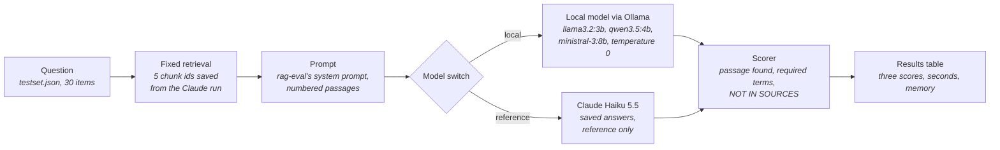

# local-vs-claude: can a small local model replace Claude on a RAG test?

**Question:** organisations with confidential documents (health services, public bodies, companies
under NDA) often cannot send text to a cloud API. If they run an open model on their own
machine instead, how much worse are the answers? This repo takes the 30-question test from
[rag-eval](https://github.com/batutho-dot/rag-eval) (same author), keeps the search step
fixed, and swaps only the model that writes the answer: three open models running locally,
with Claude Haiku 5.5 as the reference.

**Answer (30 questions, one run per model, 2026-11-19, on the PC described below):**

| Model | Runs on | Size, quantization | Right passage found | Right answer given | Unanswerable declined | Median s per answer | Total s (30 questions) | Memory used |
|---|---|---|---|---|---|---|---|---|
| Claude Haiku 5.5 (reference) | Anthropic API | not published | 17 / 20 | 20 / 20 | 10 / 10 | 0.9 | 32 | n/a (cloud) |
| `llama3.2:3b` (Meta) | this PC | 3.2B, Q4_K_M, 2.0 GB file | 17 / 20 | **13 / 20** | 10 / 10 | 3.0 | 91 | 3.1 GB, all on GPU |
| `qwen3.5:4b` (Alibaba) | this PC | 4.2B, Q4_K_M, 3.3 GB file | 17 / 20 | **20 / 20** | 10 / 10 | 10.6 | 327 | 3.3 GB, all on GPU |
| `ministral-3:8b` (Mistral AI) | this PC | 8.9B, Q4_K_M, 6.0 GB file | 17 / 20 | **20 / 20** | 10 / 10 | 13.0 | 400 | 6.3 GB, 5.9 GB on GPU |

On this test, a 4-billion-parameter model on a mid-range gaming PC matched Claude Haiku 5.5
on both answer scores, at about 10 times the answer time. The 3-billion model declined every
unanswerable question but got 7 of the 20 answerable ones wrong, mostly by replying with
passage numbers and no answer (see What failed). Scores are from the rule-based script only;
no answer here was graded by hand or by a judge model.

## The ideas, in plain words

- **Local model:** the model is a file (a few GB) that runs on your own computer through a
  program called a runtime, here [Ollama](https://ollama.com). Questions and documents never
  leave the machine; there is no API key and no per-question price, only the electricity and
  the hardware.
- **Parameters (3B, 4B, 8B):** the number of learned numbers in the model, in billions. More
  usually means better answers, more memory and slower answers.
- **Quantization:** storing each of those numbers with fewer bits. Trained models use 16 bits
  per number; `Q4_K_M` keeps about 4 to 5 bits per number. That shrinks a model about
  3 to 4 times, at some cost in quality, and is what makes an 8B model fit in an 8 GB graphics
  card. All three models here are the 4-bit versions Ollama serves by default.
- **Why GPU memory matters:** the graphics card (GPU) answers much faster than the processor,
  but only if the whole model fits in its own memory (VRAM). What does not fit spills to
  normal RAM and runs slower.
- **Fixed retrieval:** every model sees exactly the same 5 passages per question, the ones
  rag-eval's hybrid search (TF-IDF plus the `bge-small` embedding model) picked for Claude.
  So "right passage found" is the same 17 / 20 for every row, and any difference in the
  other two scores comes from the model alone.

## The machine

Measured on 2026-11-19 with Windows' own system queries (`Win32_ComputerSystem`,
`Win32_Processor`, `Win32_VideoController`) and Ollama's GPU detection log:

| Part | Value |
|---|---|
| Processor | AMD Ryzen 7 5700X, 8 cores, 16 threads |
| RAM | 32 GB (34,243,252,224 bytes) |
| GPU | AMD Radeon RX 6650 XT, 8 GB VRAM (Ollama reported 7.2 GiB available) |
| GPU backend | Vulkan (Ollama's AMD ROCm path refused the installed driver as too old) |
| OS | Windows 11 Pro |
| Runtime | Ollama 0.40.16 |
| Disk | models stored on a secondary drive with 179 GB free before download; the three models take 11 GB |

Models were picked to fit the 8 GB GPU with room for the prompt: file sizes from the tags
pages on ollama.com (read 2026-11-19): `llama3.2:3b` 2.0 GB, `qwen3.5:4b` 3.3 to 4.0 GB,
`ministral-3:8b` 6.0 GB. Three different makers and three sizes. Parameter counts and
quantization are what `ollama show` reports for the downloaded files.

## Run it

Tested on Python 3.13 (Windows 11). Install [Ollama](https://ollama.com/download) first.
From the repo folder:

```bash
python -m venv .venv
.venv/Scripts/activate        # Windows; on macOS or Linux: source .venv/bin/activate
pip install -r requirements.txt
python run.py download        # the three EU texts from EUR-Lex into data/ (about 6 MB)
python run.py                 # print the table from the saved runs
```

To make new runs (free, local; downloads about 11 GB of models):

```bash
ollama pull llama3.2:3b
ollama pull qwen3.5:4b
ollama pull ministral-3:8b
python run.py generate qwen3.5:4b     # or any other Ollama model name
python run.py                         # the table, with every run in runs/
```

`python -m lvc.check_retrieval` reruns the hybrid search and checks the passages match the
saved Claude run (needs `pip install fastembed==0.9.1`; result on 2026-11-19: 30 / 30 match).

`python verify.py` checks the code after a change in about 2 seconds without any model
(`--full` adds a real `llama3.2:3b` rerun and the retrieval check, about 3.5 minutes). What
each check covers is in `verify-features/`.

## How it is built

Every question gets the same five passages that Claude got, only the model that writes the
answer changes, and one script scores all answers the same way.



The structure diagram and a table tying each box to its file and line are in
[`docs/architecture.md`](docs/architecture.md).

## How a run works

| Step | What happens |
|---|---|
| Passages | for each question, the 5 chunk ids saved in `reference/haiku_hybrid.json` (rag-eval's Claude run with hybrid search) |
| Prompt | the same system prompt and user prompt as rag-eval, copied word for word: answer only from the numbered passages, or reply `NOT IN SOURCES` |
| Model settings | temperature 0 (always the most likely next word), context window 8,192 tokens, at most 1,024 answer tokens; `qwen3.5` has a reasoning mode, switched off (`think: false`) to match Claude at low effort |
| Warm-up | one dummy question first, so loading the model into memory is not counted as answer time (load took 7.6 s, 22.7 s and 22.2 s) |
| Time | wall-clock seconds per answer, measured in Python around the call to the local Ollama server |
| Memory | what Ollama reports for the loaded model (`/api/ps`): total, and the part held in GPU memory. 1 GB = 10^9 bytes |
| Scoring | rag-eval's own rule-based scorer (`rageval/report.py`), unchanged |

The three scores, as in rag-eval:

1. *Right passage found*: one of the 5 passages holds an accepted evidence passage.
2. *Right answer given*: the answer contains every required term of the reference answer
   and does not decline.
3. *Unanswerable declined*: for the 10 questions the texts cannot answer, the reply is
   `NOT IN SOURCES`.

## The test set

`testset.json`, copied unchanged from rag-eval: 20 answerable questions about the EU
Taxonomy, the CSRD and the ESRS, each with a reference answer and required answer terms, and
10 unanswerable ones, several of them near misses (the topic is in the law, the figure is
not). Details are in rag-eval's README.

## Results

### Where the answers went wrong

| Model | Answerable answered wrong | Of those, falsely declined | Unanswerable answered anyway |
|---|---|---|---|
| Claude Haiku 5.5 | none | none | none |
| `llama3.2:3b` | q04, q05, q10, q12, q14, q19, q20 | q12, q14 | none |
| `qwen3.5:4b` | none | none | none |
| `ministral-3:8b` | none | none | none |

### Time

| Model | Median s, answerable | Median s, unanswerable | Median answer length (tokens) |
|---|---|---|---|
| Claude Haiku 5.5 | 1.2 | 0.7 | not compared (different tokenizer) |
| `llama3.2:3b` | 3.0 | 3.0 | 26 |
| `qwen3.5:4b` | 12.5 | 7.0 | 52 |
| `ministral-3:8b` | 15.1 | 9.9 | 50.5 |

A three-word `NOT IN SOURCES` still took 7 to 10 seconds on the two larger models, so most
of their time goes into reading the roughly 1,700-token prompt, not into writing the answer.
That is an inference from these timings; the prompt-reading and writing times were not
recorded separately.

Claude's times are from rag-eval's run on the same day, over the internet from the same
PC, so they include network time.

## What failed

**`llama3.2:3b` often answered with passage numbers only.** For q05, q10, q19 and q20 the
whole reply was a citation such as `[1]` or `[2] [17] [1] (ii)`, with no answer. The prompt
asks for an answer plus the passage numbers in brackets; the smallest model kept the
brackets and dropped the answer. For q12 and q14 it declined although the passages hold the
answer, and for q04 it copied long stretches of passage text without ever stating the two kinds of information asked for. It
never invented an answer to an unanswerable question.

**The larger local models are slow on this GPU.** `ministral-3:8b` needed 6.3 GB, of which
0.4 GB did not fit in GPU memory and ran from normal RAM. Ollama's faster AMD path (ROCm)
refused the installed graphics driver as too old, so all runs used the Vulkan backend. A
newer driver, or an NVIDIA card, would likely be faster; that was not tested.

**Nothing failed for `qwen3.5:4b` and `ministral-3:8b` by the script's rule, but that rule
is lenient with long answers.** Their answers are longer than Claude's and use bold text;
the script only checks that the required terms appear. A long answer can contain the term
and still say something wrong around it. These answers were not hand-graded or judged.

## Limits

- 30 questions. One answerable question is 5 percentage points; one unanswerable is 10.
  With 20 / 20 for three models, this test cannot tell them apart; a harder test could.
- Scores are from the rule-based script only. rag-eval's Claude judge (Sonnet 5.5) was not
  run on the local answers, so no API money was spent here.
- One run per model, at temperature 0. Claude's reference run used its default settings.
- Retrieval is fixed to the passages found for Claude. A real local setup would also run the
  search locally (the embedding model here is small and does run locally).
- Times and memory hold for this PC, this driver and Ollama 0.40.16 only.
- Claude Haiku 5.5's size and quantization are not published, so the table cannot compare
  model size across the cloud and local rows.

## Source and credit

Test set, prompts, chunking, hybrid search and scorer: pinned copies from rag-eval (MIT,
same author), commit `e2cfdad`, in `pipeline/` and `rageval/`. Only `rageval/config.py` and
`rageval/report.py` of rag-eval's own code are used; its paid generate and judge steps are
left out.

EU legal texts: © European Union, https://eur-lex.europa.eu, re-used under the
Commission's reuse policy (Decision 2011/833/EU), see
https://eur-lex.europa.eu/content/legal-notice/legal-notice.html. Downloaded by
`python run.py download`, not stored in this repo. Not legal advice.

Models, run through Ollama (https://ollama.com, MIT licence): `llama3.2:3b` (Meta), `qwen3.5:4b` (Alibaba Qwen team), `ministral-3:8b` (Mistral AI); see
each model's page on ollama.com for its licence. The model files are not stored in this repo.

Code: MIT licence, see `LICENSE`.
