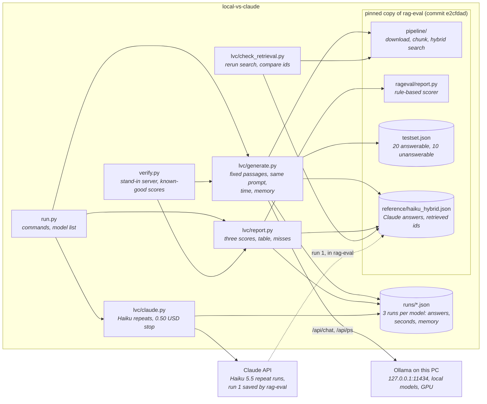
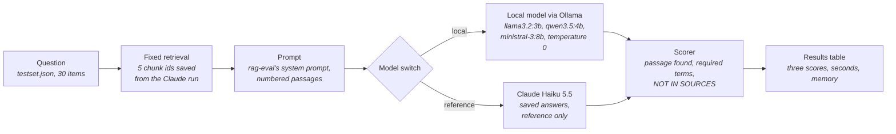

# Architecture

## (a) Structure

The repo adds a thin layer (`lvc/`) that sends rag-eval's questions to a local model and
scores the answers with rag-eval's own code, which is copied in unchanged.

## (b) One evaluation run

Every question gets the same five passages that Claude got, only the model that writes the
answer changes, and one script scores all answers the same way.

## Where each box lives

| Box | File:line | What it does |
|---|---|---|
| Commands, model list | `run.py:15` | `MODELS`, and the `report`, `download`, `generate`, `claude`, `repeat`, `all` commands |
| Fixed retrieval | `lvc/generate.py:170` | loops over the saved Claude rows and takes their `retrieved` chunk ids (line 172) |
| Prompt | `lvc/generate.py:35`, `lvc/generate.py:44` | system prompt and user prompt, copied word for word from rag-eval |
| Local model call | `lvc/generate.py:70` | `/api/chat` with temperature 0, context 8,192, `think: false` for thinking models (line 79) |
| Memory | `lvc/generate.py:178` | reads the loaded model's size and GPU share from `/api/ps` |
| Memory guard | `lvc/generate.py:119`, `lvc/generate.py:151` | refuses to load if another model is loaded or free RAM is below the model's memory plus 3 GB; unloads after the run |
| Claude repeat runs | `lvc/claude.py:42` | Haiku 5.5 on the same passages and prompt, with a 0.50 USD total stop |
| Claude reference | `lvc/generate.py:26` | `reference/haiku_hybrid.json`, rag-eval's saved hybrid run |
| Scorer | `rageval/report.py:39` | `script_grades`: passage found, required terms present, declined |
| Results table | `lvc/report.py:56` | one row per model: mean over runs and the min to max range, then each run's misses |
| Hybrid search (rerun check) | `pipeline/hybrid.py:17`, `lvc/check_retrieval.py:17` | TF-IDF plus bge-small, fused by rank; compared with the saved ids |
